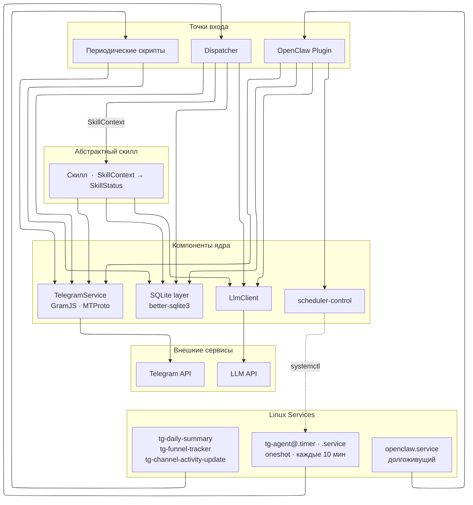
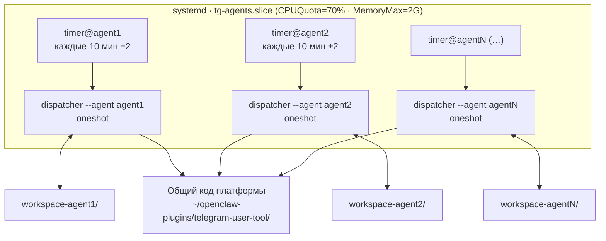
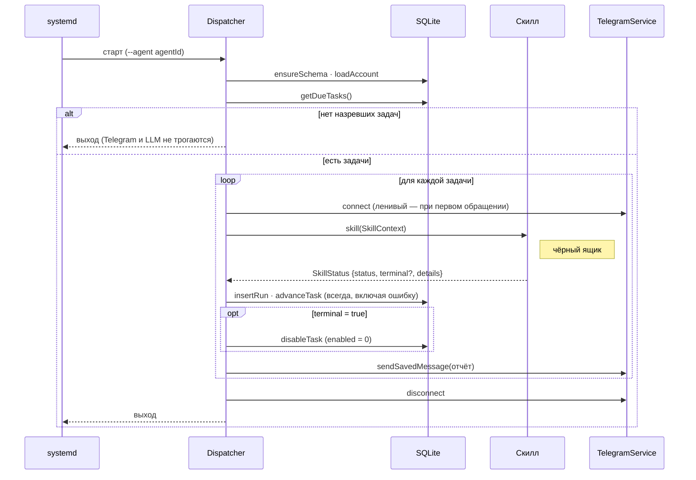
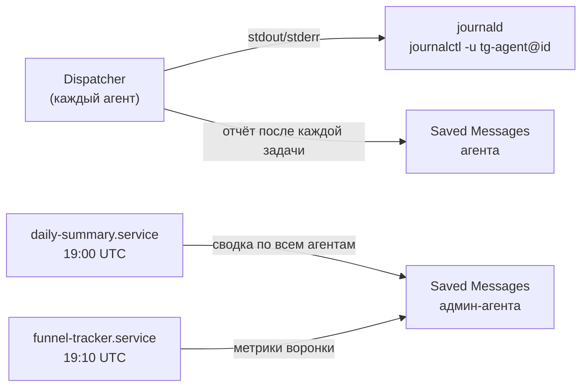

# Архитектурные диаграммы

## Компонентная архитектура

Пять слоёв сверху вниз: Linux Services запускают процессы; процессы (точки входа)
создают контекст и вызывают скиллы; **скилл** — центральная абстракция системы
(`SkillContext` → `SkillStatus`); компоненты ядра — универсальная инфраструктура,
которую используют скиллы и точки входа; внешние сервисы.
`scheduler-control` управляет таймером агента через systemctl — стрелка идёт
от L4 к L1 (обратная связь управления).

## Топология N-агентов

Один шаблон юнитов (`tg-agent@.service` / `.timer`) обслуживает N агентов через
инстансы. Агенты выполняются параллельно; задачи одного агента — последовательно
(диспетчер — точка сериализации на агента).

## Lifecycle прогона диспетчера

Ключевые инварианты: холостой прогон не трогает Telegram и LLM; `nextRun`
сдвигается всегда — и при успехе, и при ошибке скилла; сбой записи прогона или
отправки отчёта не валит прогон.

## Наблюдаемость системы

Три канала: структурированные логи → journald; per-run отчёт → Saved Messages
агента; ежедневная агрегация → Saved Messages admin-агента.

## Ролевое разделение агентов

В платформе один агент назначается **admin-агентом** (`agent1`). Он является
обычным агентом плюс получает платформенные отчёты и владеет платформенными БД.

| Возможность | Обычный агент | Admin-агент (agent1) |
|:---|:---:|:---:|
| Задачи и скиллы по расписанию | + | + |
| Изолированные БД агента | + | + |
| Per-run отчёт в собственные Saved Messages | + | + |
| Дневная сводка прогонов всех агентов | — | + |
| Воронка платформы | — | + |
| `funnel.db` (агрегат метрик) | — | + |
| `discovery.db` (реестр каналов) | — | + |

