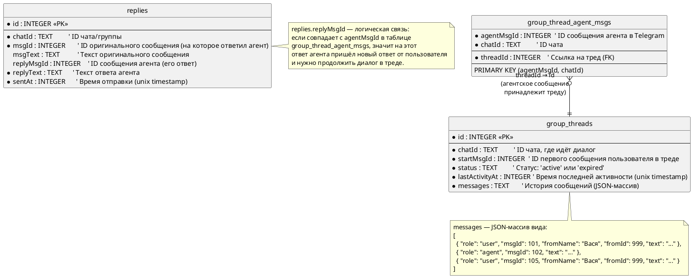

# Group Thread Replies — Фича продолжения диалога в группах

## Раздел 1: Схема базы данных



---

## Раздел 2: Как работает скилл — объяснение для команды

### Что делает агент на каждом прогоне

Агент запускается автоматически по расписанию — несколько раз в сутки. Каждый раз он делает одно и то же:

- Читает новые сообщения в группах Telegram, в которых он участвует
- Решает, на какие из них стоит ответить — исходя из своей личности и экспертизы
- Отправляет ответы
- Запоминает, что именно он написал — на случай если человек продолжит разговор

С этой фичей добавляется новый шаг: агент также проверяет, не ответил ли кто-то на его предыдущие сообщения. Если ответил — агент продолжает диалог.

---

### Как агент понимает, что ему ответили

В Telegram, когда человек нажимает "Ответить" на сообщение, новое сообщение содержит ссылку на то, на которое отвечают. Агент видит эту ссылку и проверяет: а не на его ли сообщение это ответ?

Если агент видит, что кто-то ответил именно на его реплику — он знает, что нужно продолжить разговор.

---

### Как создаётся тред (цепочка диалога)

Тред создаётся **только тогда, когда человек впервые ответил** на сообщение агента. Сам по себе монолог агента в группе — ещё не тред.

Последовательность:

1. Агент пишет что-то в группе — это обычный ответ на чьё-то сообщение
2. Человек нажимает "Ответить" на это сообщение агента
3. Агент видит этот ответ на следующем прогоне и создаёт тред
4. В тред записывается вся история: что спросил человек изначально, что ответил агент, что написал человек в ответ

С этого момента все последующие ответы человека в этой цепочке добавляются в тот же тред.

---

### Как агент отвечает, зная историю разговора

Когда агент формирует ответ в рамках треда, он видит не просто последнее сообщение человека, а всю историю разговора — кто что говорил с самого начала.

Это позволяет отвечать осмысленно:
- Не повторять то, что уже было сказано
- Учитывать уточнения и детали из предыдущих реплик
- Поддерживать связный диалог, а не выглядеть как бот, который каждый раз начинает с нуля

---

### Когда тред закрывается

Тред считается завершённым ("истёкшим"), если в нём **4 дня не было никакой активности**. Это значит, что человек перестал отвечать или разговор зашёл в тупик.

После закрытия тред переходит в статус `expired`. Агент больше не будет реагировать на старые сообщения из этой цепочки, даже если они появятся позже.

---

### Пример полного диалога с таймлайном

**День 1, 10:00** — Агент читает группу и видит сообщение:

> Вася: "Кто-нибудь пробовал автоматизировать обработку заявок через ИИ?"

Агент решает ответить и пишет в группу:

> Агент: "Да, делал это на нескольких проектах. Ключевой момент — правильно настроить классификацию входящих обращений. Если интересно, могу рассказать подробнее."

На этом этапе треда ещё нет — агент просто ответил в группе.

---

**День 1, 11:30** — Вася нажимает "Ответить" на сообщение агента:

> Вася → [ответ на сообщение агента]: "Интересно! А какой стек используете?"

**Агент на следующем прогоне (11:45) видит этот ответ и:**
- Создаёт тред
- Записывает в историю: исходный вопрос Васи + ответ агента + вопрос Васи про стек
- Формирует ответ с учётом всего контекста
- Пишет:

> Агент: "Обычно использую Python + LangChain для оркестрации, плюс свой классификатор на базе fine-tuned модели. Для небольших объёмов хватает GPT-4 через API. А у вас какой масштаб задачи?"

---

**День 2, 09:00** — Вася снова отвечает:

> Вася → [ответ на последнее сообщение агента]: "У нас ~500 заявок в день, сейчас всё руками обрабатываем"

Агент видит это на прогоне, берёт всю историю треда и отвечает:

> Агент: "500 в день — это уже хороший масштаб для автоматизации. При таком объёме окупится за 1-2 месяца. Если хотите, могу скинуть примерную архитектуру решения в личку."

---

**Следующие 4 дня** — Вася не отвечает.

**День 6** — Агент на прогоне видит, что в треде 4 дня тишина, и переводит его в статус `expired`. Тред закрыт.

---

### Жизненный цикл треда

```
[Агент написал в группе]
         |
         | (человек нажал "Ответить" на сообщение агента)
         v
    [Тред создан]  ←─────────────────────────────────────┐
    status: active                                        |
         |                                               |
         | (агент видит ответ на прогоне)                |
         v                                               |
  [Агент отвечает,                                      |
   история растёт]                                      |
         |                                               |
         |──── человек снова ответил ────────────────────┘
         |
         |──── 4 дня без активности ────────────────────┐
                                                        v
                                                  [status: expired]
                                                  Тред закрыт,
                                                  агент не реагирует
```

---

### Что важно помнить

- Агент **не навязывается** — он только реагирует, если человек сам ответил
- История диалога хранится компактно в JSON-поле, без дополнительных таблиц
- Тред привязан к конкретному чату — диалоги из разных групп не смешиваются
- Если человек написал в одной группе в разных ветках — это будут разные треды