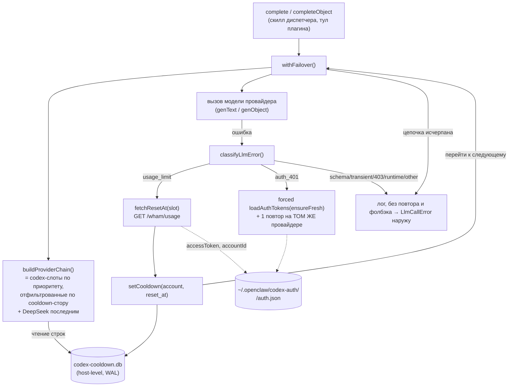

# Мультиаккаунтный failover codex-подписок с классификацией ошибок и cooldown — архитектура

Design-doc (КАК). Источник требований (ЧТО) — [requirements-v1.md](requirements-v1.md):
R1–R18, классы ошибок §6.1, критерии AC-1…AC-14 — нормативный вход, здесь не
переопределяется. Решение заземлено в коде ветки `refactoring-2`
(`src/llm/client.ts`, `src/core/config.ts`, установленные версии библиотек). Развилки,
требующие решения человека, вынесены в §9.

Код — источник истины. Расхождения с требованиями, найденные при разборе кода и
библиотек, отмечены пометкой «(расхождение)».

---

## 1. Резюме решения

- **Отказ от `ai-fallback` в пользу явного цикла failover** (§5, спайк 4). Текущий
  `createFallback({ shouldRetryThisError: () => true })` каскадит на любую ошибку и умеет
  только «перейти к следующей модели / нет» одним булевым решением. Требования требуют
  **поклассового** поведения (переход к следующему провайдеру только при `usage_limit`;
  повтор на **том же** провайдере при `auth_401`; лог без повтора для всех прочих) и
  **пропуска** аккаунтов по cooldown **до** вызова — ни то, ни другое булевым
  `shouldRetryThisError` не выражается. Цикл failover короче и проще, чем борьба с
  `ai-fallback`; зависимость `ai-fallback` удаляется.
- **Пул из N codex-аккаунтов** — по одному каталогу `~/.openclaw/codex-auth/<slot>/auth.json`
  на аккаунт; приоритет задаётся env-списком слотов. Каждый слот оборачивается своим
  `createOpenAIOAuth(openaiCredentials({ authFilePath }))` (§5, спайк 3).
- **Классификатор ошибок** — чистая функция `classifyLlmError(error)` в новом модуле
  `src/llm/error-class.ts`, по сигнатуре ai-sdk `APICallError` (`statusCode`,
  `responseBody`, `responseHeaders`) и типу JS-исключения (аналог `docs/telegram-errors.md`
  для MTProto). Возвращает один из 7 классов §6.1 (§5, спайк 5).
- **Источник момента сброса — эндпоинт `GET /backend-api/wham/usage`** (§5, спайк 1),
  вызывается **реактивно** только при классе `usage_limit`, чтобы взять `reset_at`
  исчерпанного окна. Не расходует квоту генерации (R14).
- **Cooldown-стор — host-level SQLite** `~/.openclaw/codex-cooldown.db`, общий на хост,
  одна строка на codex-аккаунт, WAL для конкурентных прогонов (§4, спайк 2). Доступность
  аккаунта перед вызовом определяется чтением этой строки (R7), без HTTP и без пробной
  генерации.
- **Граница ошибки — типизированная `LlmCallError`** (§3.3, R19). Когда вся цепочка
  провайдеров исчерпана (или класс не ведёт к фолбэку), LLM-слой бросает наружу
  `LlmCallError` с полем класса. Вызывающий отличает её от сигналов останова всего
  прогона (`PeerFloodError`, `ClientNotConnectedError`) и трактует как «пропустить
  рабочий элемент и продолжить», тем же приёмом, что уже делает `ChannelSkipError`.
- **Наблюдаемость** — структурированные лог-строки в stdout (journald), по образцу
  proxy-failure-rotation; отдельный журнал-БД не заводится (§7).
- **`createLlmClient()` остаётся процесс-уровневым и без `agentId`**: пул codex и его
  cooldown — ресурс **хоста**, общий для всех telegram-агентов и всех прогонов, не
  привязан к telegram-`agentId`. Это согласуется с тем, что токен codex уже сегодня
  host-level (`~/.openclaw/codex-auth/auth.json`), а не per-agent.

---

## 2. Компоненты и взаимодействие

Новый код сосредоточен в LLM-слое (`src/llm/`) плюс один модуль хранилища в
`src/core/db/`. Точки входа (диспетчер, плагин, ops-скрипты) не меняются — они вызывают
`createLlmClient()` как прежде.

| Компонент | Файл | Ответственность |
|---|---|---|
| LLM-клиент | `src/llm/client.ts` (изменяется) | Публичный контракт `complete`/`completeObject`; 3-слойная деградация structured output (без изменений по сути, §6); оборачивает каждый top-level вызов в цикл failover |
| Цикл failover | `src/llm/failover.ts` (новый) или внутри `client.ts` | Строит цепочку провайдеров (cooldown-фильтр + приоритет + DeepSeek), вызывает модель, по классу ошибки решает: перейти дальше / повтор на том же / аварийно завершить |
| Пул codex | `src/llm/codex-pool.ts` (новый) | Обнаружение слотов аккаунтов, порядок приоритета, сборка `createOpenAIOAuth` на слот, чтение/рефреш токена (`loadAuthTokens`), запрос `/wham/usage` и парсинг `reset_at` |
| Классификатор | `src/llm/error-class.ts` (новый) | `classifyLlmError(error) → LlmErrorClass`; таблица сигнатур §6.1; тип `LlmCallError` (граница наружу, §3.3) |
| Cooldown-стор | `src/core/db/codex-cooldown.ts` (новый) | SQLite host-level: `getCooldownUntil`, `setCooldown`, `listAvailable` |
| Конфигурация | `src/core/config.ts` (изменяется) | `CODEX_ACCOUNTS`, пути слотов, дефолты |



**Жизненный цикл.** `createLlmClient()` вызывается один раз на процесс (диспетчер —
модульный `const llm`, плагин — на тул). Цепочка провайдеров строится **на каждый
top-level вызов** `complete`/`completeObject` — чтение cooldown-стора дёшево (точечные
SELECT), и это даёт свежую картину: cooldown, выставленный предыдущим вызовом того же
прогона, учитывается следующим (AC-8 внутри прогона и между прогонами). Состояние в
памяти между прогонами не живёт — единственный носитель решения о доступности — стор
(R10).

---

## 3. Поток выбора провайдера и обработка ошибок по классам

Цепочка на момент вызова: `[codex-слот₁, codex-слот₂, …]` (в порядке приоритета, **без**
тех, у кого `cooldown_until > now`), затем `DeepSeek`. DeepSeek из цепочки не исключается
по cooldown — у него своя тарификация, он всегда последний предохранитель (R8, AC-7).

**Контракт `withFailover`.** Принимает «запуск генерации на модели» (`genText` для
`complete`, пайплайн слоёв схемы §6 для `completeObject`), строит цепочку провайдеров
через `buildProviderChain()` и возвращает результат первого успешного. На ошибке — решает
по классу (`classifyLlmError`, §5): только `usage_limit` ведёт к переходу на следующий
провайдер с повтором (предварительно читает `/wham/usage`, выставляет cooldown), только
`auth_401` — к одному повтору на том же провайдере после принудительного рефреша. Все
прочие классы завершают цикл сразу. Когда цепочка исчерпана (или класс не ведёт к
фолбэку), наружу уходит `LlmCallError` (§3.3) — не «сырое» исключение провайдера и не
`Error`-строка. Решение о cooldown/рефреше/останове принимает цикл; классификатор о
провайдерах и сторе не знает.

Поток решений по классам §6.1:

| Класс | Сигнатура (как распознаём) | Действие в цикле | R / AC |
|---|---|---|---|
| `usage_limit` | `APICallError` 429 ∨ тело «usage limit has been reached» ∨ непустой заголовок `x-codex-*-rate-limit-reached-type` | `/wham/usage` → cooldown до `reset_at` → **следующий провайдер, повтор** | R4,R5,R6,R15; AC-4,AC-5 |
| `schema_error` | `APICallError` 400 ∧ тело «Invalid schema for response_format»; а также ZodError / JSON-parse / финальный исход слоёв `completeObject` | лог, **без повтора и фолбэка** → `LlmCallError` | R12,R15; AC-2 |
| `transient` | `APICallError` 5xx; сетевой таймаут/разрыв (`ConnectTimeoutError`, `fetch` `TypeError`), `isRetryable` | лог, **без повтора и фолбэка** → `LlmCallError` | R13,R15; AC-3 |
| `auth_401` | `APICallError` 401 | рефреш токена + **1 повтор на том же провайдере**; рефреш не удался → лог, `LlmCallError` | R16,R15; AC-11 |
| `auth_403` | `APICallError` 403 | лог, **без повтора и фолбэка** → `LlmCallError` | R17; AC-12 |
| `runtime_error` | JS-исключение не от API (`TypeError`/`ReferenceError` в коде слоя) | лог, **без повтора и фолбэка** → `LlmCallError` | R18; AC-13 |
| `other` | ошибка, не подпавшая выше (вкл. DeepSeek «Insufficient Balance») | лог, **без повтора и фолбэка** → `LlmCallError` (консервативно) | R15; AC-14 |

Единственный класс с переходом к следующему провайдеру и повтором — `usage_limit`;
единственный класс с повтором на том же провайдере — `auth_401` (AC-14). Все остальные
завершают вызов неуспехом — наружу уходит `LlmCallError` (§3.3), которую per-item цикл
скилла трактует как «пропустить элемент» (R19), а не как падение прогона. Исчерпание всей
цепочки (все codex на cooldown и DeepSeek неуспешен) — тот же `LlmCallError` наружу.

### 3.1 Взаимодействие failover с 3-слойной деградацией схемы

`completeObject` сегодня деградирует схему в пределах **одной** модели (нативный
structured output → текст+фидбэк → coerce, §6). Это ортогонально выбору провайдера.
Опасность: слой 1 ловит ошибку через `catch {}` **без разбора** и спускается на текстовый
путь той же модели. Если это был `usage_limit`, текстовый путь снова упрётся в лимит, а
финальный throw будет обычным `Error` («валидный JSON не получен») — классификатор отнёс
бы его к `schema_error`, и **failover не сработал бы** (расхождение с R6, которое текущий
слепой `catch` замаскировал).

Решение: деградацию схемы ведут **только** классы `schema_error` (и «structured output не
поддержан»). Любой другой класс (`usage_limit`/`auth_401`/`auth_403`/`transient`/
`runtime_error`) **пробрасывается наружу** из `completeObject` в цикл failover, а не
глохнет в `catch`. Граница: слепой `catch {}` слоя 1 и `catch` слоя 2 ловят ошибку
**только** если её класс — `schema_error`; иначе немедленно пробрасывают (классификатор —
общий, §5). Тогда весь пайплайн схемы для **одного** провайдера — это единица, которую
исполняет цикл failover; провайдерная ошибка всплывает в цикл, схемная остаётся внутри и
не вызывает фолбэк (R12). `complete` (свободный текст) слоёв не имеет — там единица цикла
это один вызов `genText`.

### 3.3 Граница распространения ошибки: `LlmCallError` vs сигналы останова прогона (R19)

Неуспех LLM-вызова по **одному рабочему элементу** (канал, тред, пост, DM-кандидат) не
должен ронять весь прогон (R19, AC-15). Корень текущей проблемы (20 `status=error` у
monitor-v5 02.10): per-item `catch` скилла знает только три сигнала (`FloodAbortError`,
`PeerFloodError`, `ClientNotConnectedError`) и `ChannelSkipError`, а **всё прочее** делает
`throw err` — любая ошибка `llm.complete`/`llm.completeObject` вылетает из цикла по
элементам и прекращает прогон.

**Контракт LLM-слоя наружу.** `complete`/`completeObject` при неуспехе бросают **одну**
типизированную ошибку — `LlmCallError extends Error` с полем `errorClass: LlmErrorClass`
(§5) и исходной причиной (`cause`). Это единственный тип, которым LLM-слой сигналит о
неуспехе вызова. Он намеренно **не** является `ClientNotConnectedError` и не порождает
`PeerFloodError` — то есть по типу отличим от сигналов, которые обязаны останавливать весь
прогон (обрыв связи с Telegram, PEER_FLOOD уровня аккаунта). `usage_limit` и `auth_401`
обрабатываются **внутри** `withFailover` и наружу как `LlmCallError` **не** выходят, пока
есть куда переключиться; `LlmCallError` наружу означает «этот логический вызов не удался»
— в том числе когда цепочка исчерпана целиком.

**Где ловится — на уровне per-item цикла скилла.** Единица изоляции — рабочий элемент, а
не отдельный вызов LLM (один элемент может делать несколько вызовов: скоринг + ответ).
Поэтому `LlmCallError` ловит тот же внешний `catch` цикла по элементам, что уже ловит
`ChannelSkipError`, и реакцией он эквивалентен skip: залогировать, пометить элемент
обработанным (чтобы не зациклиться на нём в следующем прогоне), увеличить счётчик
пропусков, `continue`. Вверх (в диспетчер) `LlmCallError` **не** пробрасывается.

**Что меняется у потребителей.** В per-item `catch` каждого скилла-потребителя добавляется
ветка `LlmCallError` → skip-элемент, **перед** финальным `throw err`. Порядок веток
важен: `ClientNotConnectedError` и `PeerFloodError` по-прежнему пробрасываются/останавливают
прогон (они не `LlmCallError`), финальный `throw err` остаётся для действительно
непредвиденных исключений. Пример точки — `src/skills/monitor-v5.ts`, внешний `catch`
канала (ветки `FloodAbortError`/`PeerFloodError`/`ChannelSkipError`, затем `throw err`):
добавить ветку `LlmCallError`, повторяющую обработку `ChannelSkipError`
(`markChannelProcessed` + `continue`). Аналогично — в `monitor-v3`/`monitor-v4`/`monitor-v2`
и прочих местах, где результат `llm.*` используется внутри per-item цикла (список — §6).

---

## 4. Модель данных cooldown-стора (спайк 2)

Cooldown — изменяемое операционное состояние **codex-аккаунта** (ресурс хоста), общее для
всех telegram-агентов и всех параллельных прогонов. Пишется редко (только при
`usage_limit`), читается на каждый top-level LLM-вызов.

### Где файл

| Критерий | (а) host-level `~/.openclaw/codex-cooldown.db` **(рекомендуется)** | (б) таблица в workspace админ-агента (как `agent-restrictions.db`) |
|---|---|---|
| «Один факт — один дом» | Дом совпадает с домом пула: токены уже лежат host-level в `~/.openclaw/codex-auth/`. Cooldown — свойство этого host-level пула | Пул codex к админ-агенту отношения не имеет; класть его состояние в workspace telegram-агента — чужой дом |
| Прецедент | Нет host-level `.db` (все БД сейчас per-agent или в admin-workspace) — новый паттерн | Есть прецедент платформенных БД в admin-workspace |
| Общий доступ | Прямо отражает «общее на хост» (R10) | Тоже общее, но через заимствование admin-workspace |
| Связанность | Нулевая зависимость от telegram-контура | Привязка к `FUNNEL_ADMIN_AGENT_ID` — лишняя связь LLM-слоя с воронкой |

Рекомендация — **(а)**: cooldown живёт рядом с тем, чьим состоянием он является (пул
codex host-level). Отсутствие host-level прецедента — не препятствие: это первый
действительно host-level, а не per-agent ресурс с изменяемым состоянием. Решение за
человеком (§9-A).

### Схема

```sql
CREATE TABLE IF NOT EXISTS codex_cooldown (
    account_id     TEXT    PRIMARY KEY,  -- стабильный id слота (имя каталога слота), не accessToken
    cooldown_until INTEGER,              -- unix sec: момент сброса (макс по исчерпанным окнам). NULL/прошлое = доступен
    reached_type   TEXT,                 -- rate_limit_reached_type последнего исчерпания (диагностика/лог)
    checked_at     INTEGER NOT NULL      -- когда последний раз читали /wham/usage
);
```

- `cooldown_until` — единственное несущее поле доступности. `NULL` или значение в прошлом
  → аккаунт доступен; `> now` → на cooldown (R7, AC-6). Отдельного булева «статуса» нет
  (принцип простоты: статус выводится из `cooldown_until` и часов, лишнее поле не
  заводим).
- `reached_type` / `checked_at` — диагностика для оператора и логов; на решение о
  доступности не влияют.
- `used_primary/used_secondary` из формулировки спайка **не храним**: `used_percent`
  нужен был бы только проактивному поллингу остатка, которого в этом решении нет (момент
  сброса берём реактивно, см. спайк 1). Поля без текущего потребителя не добавляем. При
  появлении дашборда расхода квот — отдельным change.

### Интерфейс модуля `core/db/codex-cooldown.ts`

Границы наружу (по стилю `core/db/proxy-health.ts`): три операции, скрывающие SQLite от
LLM-слоя.

| Функция | Назначение | Кто вызывает |
|---|---|---|
| `listAvailableAccounts(slots): string[]` | из переданного списка слотов вернуть те, у кого нет активного cooldown (`cooldown_until` ≤ now ∨ нет строки); порядок приоритета сохраняется | `buildProviderChain()` на каждый top-level вызов |
| `setCooldown(accountId, cooldownUntil, reachedType): void` | атомарно выставить момент сброса слота | цикл failover в ветке `usage_limit` |
| `getCooldownUntil(accountId): number \| null` | момент сброса конкретного слота (для лога «пропуск по cooldown») | наблюдаемость (§7) |

Ключ — **стабильный идентификатор слота** (имя каталога слота, напр. `acc1`), а не
`accessToken` (ротируется рефрешем) и не `accountId` из `/wham/usage` (его может не быть
на момент записи при неуспехе usage-запроса). Слот — стабильная единица приоритета и
единственное, что известно всегда.

### Конкурентность

Прогоны — параллельные процессы, пишущие/читающие один файл: БД открывается в WAL
(конкурентные читатели + один писатель) с busy-timeout. Запись — атомарный upsert одной
строки: `cooldown_until` — детерминированное бэкендом значение из свежепрочитанного
`/wham/usage`, перезапись «последним писателем» корректна, read-modify-write-гонки нет.
Модуль повторяет паттерн `core/db/proxy-health.ts`/`llm-log.ts` (открыть → ensure-schema →
prepared statement → `finally` close).

### TTL свежести

Отдельного TTL перечитывания `/wham/usage` **нет**: `cooldown_until` сам себе срок
годности. После наступления `reset_at` аккаунт снова считается доступным и пробуется; если
лимит ещё держится — приходит новый 429, и `/wham/usage` читается заново, обновляя
`cooldown_until`. Это проще периодического поллинга и не тратит лишних HTTP (спайк 1).

---

## 5. Разрешение спайков

### Спайк 1 — источник момента сброса: `/wham/usage`, реактивно

Выбран **эндпоинт `GET https://chatgpt.com/backend-api/wham/usage`**, а не заголовки
`x-codex-*` ответов генерации.

| Критерий | `/wham/usage` (выбран) | заголовки `x-codex-*` |
|---|---|---|
| Надёжность `reset_at` | Полный JSON по обоим окнам, `reset_at` точный | По issues местами пусты или `-1` (requirements §8) |
| Стоимость | 1 лишний HTTP, но **только** при `usage_limit` (редко) и без траты квоты генерации (R14) | «Бесплатны» (едут с ответом), но ненадёжны |
| Момент запроса | Реактивно, когда нужно выставить cooldown | Пришлось бы парсить на каждом ответе |

Механика `fetchResetAt(slot)`:
1. `loadAuthTokens({ authFilePath: slot.authFile, fetch, ensureFresh: true })` →
   `{ accessToken, accountId }` (эта же функция делает рефреш access-token по
   refresh-token — см. спайк 4 про 401).
2. `GET /backend-api/wham/usage` с заголовками `Authorization: Bearer <accessToken>`,
   `chatgpt-account-id: <accountId>`, `originator: codex_cli_rs`.
3. Из `rate_limit.primary_window` и `secondary_window` взять `reset_at` тех окон, что
   исчерпаны (признак исчерпания — `limit_reached`/непустой `rate_limit_reached_type`;
   при неоднозначности берём оба). `cooldown_until = max(reset_at исчерпанных окон)` (R5,
   AC-5).
4. Если эндпоинт сам недоступен/вернул мусор — консервативный фолбэк: `cooldown_until =
   now + reset_after_seconds` (если есть) либо фиксированное безопасное окно (напр.
   primary = 5 ч), и всё равно переход к следующему провайдеру. Аккаунт не «подвисает»
   из-за сбоя вспомогательного эндпоинта. Значение фолбэк-окна — на согласование (§9-D).

Заголовки `x-codex-*` оставляем как возможный будущий бесплатный источник (если бэкенд
начнёт их заполнять) — в этой фиче не используем.

### Спайк 2 — хранилище cooldown

Разрешено в §4: host-level `~/.openclaw/codex-cooldown.db`, одна строка на слот, WAL,
ключ — имя слота, TTL = сам `cooldown_until`.

### Спайк 3 — провижининг N OAuth-токенов

**Раскладка файлов.** Один каталог на аккаунт:
`~/.openclaw/codex-auth/<slot>/auth.json`. Каждый слот — независимый OAuth-контекст
библиотеки (`openaiCredentials({ authFilePath })` принимает путь к конкретному файлу —
подтверждено сигнатурой `@openai-oauth/local`).

**Обратная совместимость.** Если каталогов слотов нет, но существует легаси-файл
`~/.openclaw/codex-auth/auth.json` — он трактуется как единственный слот `default`
(поведение «один аккаунт» сохраняется без миграции).

**Порядок приоритета.** Env-список имён слотов, по образцу существующих секретов из
`~/.openclaw/secrets.env`:

```
CODEX_ACCOUNTS=acc1,acc2,acc3   # строгий приоритет слева направо (R3)
```

Пусто/не задан → обнаружить подкаталоги `codex-auth/*/` и отсортировать по имени (плюс
легаси-`default`). Явный список всегда главнее автодискавери — оператор управляет и
составом, и порядком одним местом.

**Контракт цепочки** (`codex-pool.ts`). `buildProviderChain()` возвращает упорядоченный
список дескрипторов провайдера:

```
interface ProviderEntry {
    kind: "codex" | "deepseek";
    label: string;                 // для логов: "codex:acc1" / "deepseek"
    accountId?: string;            // имя слота — ключ cooldown-стора (только codex)
    authFile?: string;             // путь auth.json слота (только codex, для fetchResetAt/рефреша)
    model: LanguageModelV3;        // codex-слот: createOpenAIOAuth(openaiCredentials({authFilePath}))("gpt-6-luna")
}
```

Порядок: codex-слоты по приоритету, отфильтрованные через `listAvailableAccounts` (§4),
затем один `deepseek`-дескриптор в конце (R8). DeepSeek по cooldown не фильтруется.

**Конфигурация в `config.ts`:** `codexAuthRoot()` (= `~/.openclaw/codex-auth`),
`codexCooldownDbPath()`, `CODEX_ACCOUNTS`. Имя модели `gpt-6-luna` остаётся (сегодня в
коде), её достижимость гейтится `minimal_client_version` на стороне бэкенда — риск §9-C.

**Эксплуатация (не проектируется здесь).** Оператор выполняет `codex login` на каждый
слот, направляя вывод в `~/.openclaw/codex-auth/<slot>/auth.json` (механику логина эта
фича не реализует). Описание — в `docs/configuration.md` при реализации.

### Спайк 4 — механика failover: явный цикл вместо `ai-fallback`

| Вариант | За | Против |
|---|---|---|
| Оставить `ai-fallback`, настроить `shouldRetryThisError` + динамический `models` | ноль нового кода цикла | булев `shouldRetryThisError` не различает «следующий провайдер» и «тот же + рефреш» (401); cooldown-пропуск до вызова требует пересборки `models` каждый вызов; слепой `catch` слоя 1 всё равно ломает классификацию (§3.1) — пришлось бы и его править |
| **Явный цикл `withFailover`, убрать `ai-fallback` (рекомендуется)** | прямое отображение §6.1; cooldown-фильтр до вызова; повтор на том же провайдере при 401; минус внешняя зависимость | ~50–70 строк своего кода цикла |

Рекомендация — **явный цикл** (§3). Простота здесь на стороне явного цикла: `ai-fallback`
навязывает одно булево решение, а требования описывают три разных реакции плюс
предварительный пропуск по cooldown. Зависимость `ai-fallback` удаляется из
`package.json`.

**Нюанс 401/рефреша (из ключевых фактов, разбираем явно).** Библиотека
`@openai-oauth/*` сама авто-рефрешит access-token по refresh-token. Значит `401` доходит
до приложения, **только** если протух сам refresh-token. Тогда «обновить токен» =
релогин, что вне этой фичи. Практический эффект R16: ветка `auth_401` делает **один**
принудительный `loadAuthTokens({ ensureFresh: true })` (вдруг помогло) и повтор на том же
провайдере; если снова 401 / рефреш не удался — лог без каскада. То есть R16 вырождается в
«рефреш не сработал → лог без повтора», переход к другому провайдеру при 401 не
происходит (AC-11). Cooldown при 401 не ставится.

### Спайк 5 — классификатор

`src/llm/error-class.ts` — чистая функция без побочных эффектов (аналог
`docs/telegram-errors.md` для MTProto):

```
type LlmErrorClass =
  "usage_limit" | "schema_error" | "transient" | "auth_401" | "auth_403" | "runtime_error" | "other";

function classifyLlmError(err: unknown): LlmErrorClass
```

Сопоставление сигнатуры классу (порядок проверки — сверху вниз, первое совпадение):

| Приоритет | Сигнатура | Класс |
|---|---|---|
| 1 | `APICallError`: 429 ∨ тело «usage limit has been reached» ∨ непустой заголовок `x-codex-*-rate-limit-reached-type` | `usage_limit` |
| 2 | `APICallError`: 400 ∧ тело «Invalid schema for response_format» | `schema_error` |
| 3 | `APICallError`: 401 | `auth_401` |
| 4 | `APICallError`: 403 | `auth_403` |
| 5 | `APICallError`: ≥ 500 | `transient` |
| 6 | не-API сетевой сбой (`ConnectTimeoutError` / `fetch TypeError` / `ETIMEDOUT`) | `transient` |
| 7 | `ZodError` / JSON-parse / исчерпание слоёв `completeObject` (исход схемы, не провайдер) | `schema_error` |
| 8 | прочий `APICallError` без совпадения выше | `other` |
| 9 | прочее JS-исключение в коде слоя | `runtime_error` |

Классификатор не знает о cooldown-сторе и провайдерах — только «что за ошибка»; решение
(cooldown / рефреш / `LlmCallError`) принимает цикл (§3). `other` отделён от
`runtime_error`: `other` — нераспознанный **ответ API** (вкл. DeepSeek «Insufficient
Balance»), `runtime_error` — исключение **в нашем коде**; оба ведут к «лог без повтора»,
но разделены для диагностики (§6.1).

### Спайк 6 — наблюдаемость

Разрешено в §7.

---

## 6. Влияние на `src/llm/client.ts`

- **Удаляется** `createFallback` и статический двухмодельный `model`. Вместо него —
  `buildProviderChain()` на каждый top-level вызов и обёртка `withFailover(run)`.
- **`createLlmClient()`** — сигнатура без изменений (без `agentId`): все вызывающие
  (`dispatcher.ts`, `index.ts`, ops-скрипты) продолжают звать как есть. `withLlmLogging`
  поверх — тоже без изменений (оборачивает уже готовый клиент).
- **`complete`** — единица цикла — один вызов генерации текста; результат первого
  успешного провайдера возвращается, иначе — `LlmCallError`.
- **`completeObject`** — пайплайн 3 слоёв схемы (§6) становится единицей цикла (§3.1);
  слепые `catch` слоёв 1–2 ловят ошибку только класса `schema_error`, прочее пробрасывают
  в цикл. Логика coerce/фидбэка не меняется.
- **Контракт наружу** — `complete`/`completeObject` при неуспехе бросают `LlmCallError`
  (§3.3) вместо «сырого» исключения провайдера или `Error`-строки. Публичные сигнатуры
  `LlmClient` (`complete`/`completeObject`) по типам не меняются — меняется только тип
  бросаемой ошибки (с `unknown`/`Error` на `LlmCallError`).
- **`requestCount`** — семантика сохраняется: инкремент на каждом round-trip, включая
  повторы при failover и 401 (честно отражает нагрузку).
- **DeepSeek** — остаётся по `process.env.DEEPSEEK_API_KEY`, но его отсутствие больше не
  обязано быть фатальным на старте: при наличии codex-пула DeepSeek — опциональный хвост
  цепочки. Сейчас конструктор бросает при отсутствии ключа — предлагается смягчить
  (иначе пул codex не стартует без DeepSeek). Решение за человеком (§9-E).

**Скиллы-потребители (R19, §3.3).** В per-item `catch` каждого скилла, вызывающего
`llm.*` внутри цикла по элементам, добавляется ветка `LlmCallError` → «пропустить элемент
и продолжить» (как `ChannelSkipError`), перед финальным `throw err`:
- `src/skills/monitor-v5.ts` — внешний `catch` канала (ответы new-thread/continuation,
  скоринг DM); точка, давшая 20 `status=error` 02.10.
- `src/skills/monitor-v4.ts`, `src/skills/monitor-v3.ts`, `src/skills/monitor-v2.ts` —
  те же per-channel `catch` с `ChannelSkipError`/`PeerFloodError`.
- Прочие потребители `createLlmClient` вне per-item-цикла (ops-скрипты
  `channel-niche`/`discovery-similar`/`metrics-pipeline-worker`, фичи
  `channel-context`/`channel-analysis`) — у них своя единица изоляции (канал в своём
  цикле); там `LlmCallError` ловится их существующим per-item `catch`/`FloodStop`-контуром
  тем же приёмом. Точечный аудит при реализации.

**Новые модули** (§2): `src/llm/failover.ts`, `src/llm/codex-pool.ts`,
`src/llm/error-class.ts` (включая тип `LlmCallError`), `src/core/db/codex-cooldown.ts`.
Разнесение — тестируемость классификатора и стора по отдельности.

---

## 7. Наблюдаемость (R11)

Канал — stdout процесса (journald systemd-юнита / логи прогонов на VPS), как у текущего
`onError` и у proxy-failure-rotation. Отдельный журнал-БД не заводится (один факт — один
дом): успешные вызовы уже пишет `llm_log`, строка `codex_cooldown` (`cooldown_until`,
`reached_type`, `checked_at`) инспектируема оператором. События, все структурированными
строками с префиксом `[llm]`:

- **Обслужено** (`info`): какой провайдер/слот отдал ответ (`codex:acc1` / `deepseek`),
  текущий `requestCount`. Закрывает «какой аккаунт обслуживает генерацию» (AC-9).
- **Переключение** (`warn`): с какого слота, класс-причина, на какой провайдер перешли.
  Пишется в точке `continue` цикла (AC-9).
- **Cooldown выставлен** (`warn`): слот, `cooldown_until` (ISO + unix), `reached_type`,
  какое окно исчерпано. Закрывает «до какого момента выведен на cooldown» (AC-9).
- **Пропуск по cooldown** (`info`): при построении цепочки слот пропущен, до какого
  момента (видно, почему приоритетный аккаунт не использован).
- **401/рефреш** (`warn`/`error`): попытка принудительного рефреша и её исход.
- **Все исчерпаны** (`error`): все codex на cooldown и DeepSeek недоступен — крайнее
  состояние.

Шум при норме не плодим: при пустом cooldown и первом же успешном провайдере — одна
строка `info` «обслужено».

---

## 8. Трассировка требований → решение

| Требование | Где |
|---|---|
| R1 (классификация каждой ошибки) | §5 спайк 5 (`classifyLlmError`), §3 таблица |
| R2 (cooldown только при `usage_limit`) | §3 цикл (только ветка `usage_limit` пишет cooldown) |
| R3 (строгий приоритет, не round-robin) | §5 спайк 3 (порядок слотов), §3 (цепочка в порядке) |
| R4 (запомнить момент сброса, cooldown) | §3 ветка `usage_limit`, §5 спайк 1 |
| R5 (reset_at исчерпанного окна, макс по окнам) | §5 спайк 1 шаг 3 |
| R6 (переход к следующему доступному → DeepSeek) | §3 цикл (`continue`), §5 спайк 3 (DeepSeek хвост) |
| R7 (доступность по сохранённой дате, не пробой) | §4 (`cooldown_until`), §2 (чтение стора при сборке цепочки) |
| R8 (DeepSeek последний) | §5 спайк 3 (DeepSeek-дескриптор в конце цепочки) |
| R9 (зависимость от баланса DeepSeek) | §6 (DeepSeek опциональный хвост), §9-E |
| R10 (cooldown общий на хост, переживает рестарт) | §4 (host-level SQLite) |
| R11 (наблюдаемость переключений/cooldown) | §7 |
| R12 (schema_error: лог, без повтора/фолбэка) | §3 таблица, §3.1 (не глохнет в `catch`) |
| R13 (transient: лог, без повтора/фолбэка) | §3 таблица |
| R14 (проверка остатка не тратит квоту) | §4 (доступность = чтение стора), §5 спайк 1 (`/wham/usage` без генерации) |
| R15 (повтор только usage_limit + 401) | §3 цикл (остальные классы → `LlmCallError`) |
| R16 (401: рефреш + повтор на том же; иначе лог) | §5 спайк 4 нюанс 401 |
| R17 (403: лог, без повтора/фолбэка) | §3 таблица |
| R18 (runtime_error: лог, без повтора/фолбэка) | §3 таблица, §5 спайк 5 |
| R19 (ошибка элемента не роняет прогон) | §3.3 (`LlmCallError` → skip-элемент в per-item `catch`), §6 (скиллы-потребители) |
| AC-15 (прогон продолжает остальные элементы) | §3.3, §6 (ветка `LlmCallError` в monitor-v2/v3/v4/v5) |

---

## 9. Открытые вопросы (решение за человеком)

- **§9-A. Дом cooldown-стора.** Рекомендация — host-level
  `~/.openclaw/codex-cooldown.db` (§4): нет host-level прецедента, но дом совпадает с
  домом пула codex. Альтернатива — admin-workspace, как `agent-restrictions.db` (есть
  прецедент, но лишняя привязка LLM-слоя к воронке). Подтвердить вариант.
- **§9-B. Задание пула и приоритета.** Рекомендация — env `CODEX_ACCOUNTS` (список слотов
  слева направо) + автодискавери подкаталогов при пустом env, легаси-`auth.json` =
  `default` (§5 спайк 3). Подтвердить формат и расположение слотов.
- **§9-C. Версия модели / `minimal_client_version`.** `gpt-6-luna` (min_client 0.155;
  библиотека шлёт 0.160). При смене модели или подъёме `minimal_client_version` бэкендом
  достижимость может отвалиться — это внешняя зависимость, не логика фичи. Нужно ли
  фиче вообще знать про `/backend-api/codex/models` (гейт достижимости), или оставляем
  фиксированное имя и ловим ошибку как `other`? Рекомендация — оставить фиксированное имя
  (простота), версионные сбои ловятся классификатором как `other` (лог, без каскада).
- **§9-D. Фолбэк-окно cooldown при недоступности `/wham/usage`** (§5 спайк 1 шаг 4). Какое
  безопасное значение по умолчанию (predлагается primary-окно 5 ч = 18000 с)?
- **§9-E. DeepSeek опционален.** **РЕШЕНО: отклонено — оставляем как есть, `DEEPSEEK_API_KEY`
  остаётся обязательным.** Ключ у нас всегда задан (неуспехи DeepSeek 02.10 — `Insufficient
  Balance`, т.е. нулевой баланс при рабочем ключе, а не отсутствие ключа). Сценарий «ключа
  нет» неактуален; конструктор `createLlmClient` не трогаем. Реальная проблема DeepSeek —
  баланс, а не ключ; это отдельный операционный вопрос вне данной фичи.
- **§9-F. Риск скоррелированной блокировки пула codex** — требованиями **принят** владельцем
  (§4 требований), в фичу не входит. Зафиксировано как контекст, не задача.

---

## 10. Файлы-опоры

- `src/llm/client.ts` — удаление `ai-fallback`, обёртка `withFailover`, правка `catch`
  слоёв `completeObject` (§3.1, §6).
- `src/llm/failover.ts` (новый) — цикл выбора провайдера и обработки классов (§3).
- `src/llm/codex-pool.ts` (новый) — слоты, приоритет, `createOpenAIOAuth` на слот,
  `loadAuthTokens`, `fetchResetAt` (`/wham/usage`) (§5 спайки 1,3).
- `src/llm/error-class.ts` (новый) — `classifyLlmError` и тип `LlmCallError` (§5 спайк 5,
  §3.3).
- `src/core/db/codex-cooldown.ts` (новый) — host-level стор, по образцу
  `core/db/proxy-health.ts` (§4).
- `src/core/config.ts` — `codexAuthRoot()`, `codexCooldownDbPath()`, `CODEX_ACCOUNTS` (§5
  спайк 3).
- `src/skills/monitor-v5.ts` (+ `monitor-v4`/`monitor-v3`/`monitor-v2`) — ветка
  `LlmCallError` → skip-элемент в per-channel `catch` (§3.3, §6, R19).
- `package.json` — удалить зависимость `ai-fallback`.
- `docs/configuration.md`, `docs/telegram-errors.md` (или новый каталог ошибок LLM) —
  обновить при реализации (эксплуатация пула, таблица классов).
